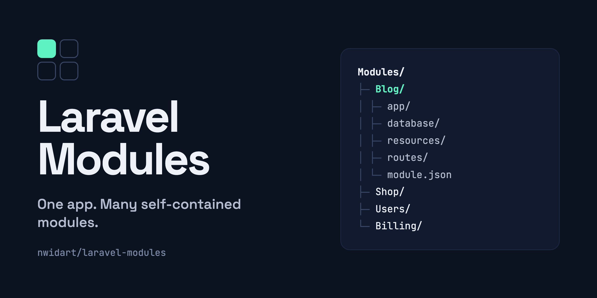

<p align="center"></p>

[](https://packagist.org/packages/nwidart/laravel-modules) [](LICENSE.md) [](https://github.com/nWidart/laravel-modules/actions/workflows/php.yml) [](https://packagist.org/packages/nwidart/laravel-modules)

## What it does

- Splits a large Laravel app into modules that live in `Modules/`.
- Each module is a self-contained unit with its own service providers, routes, controllers, models, views, migrations, config and translations. It works like a small Laravel package inside your app.
- Modules can be enabled or disabled. Only enabled modules are booted. Status is stored by an activator (a JSON file by default).
- Artisan generators create modules and the classes inside them: `module:make`, `module:make-controller`, `module:make-model`, `module:make-migration`, and more.

`php artisan module:make Blog` generates:

```
Modules/Blog/
├── app/            Http/Controllers, Providers
├── config/
├── database/       factories, migrations, seeders
├── resources/      assets, views
├── routes/         web.php, api.php
├── tests/          Feature, Unit
├── composer.json
├── module.json
├── package.json
└── vite.config.js
```

## Requirements

PHP 8.3+ and Laravel 13 for the current version. See [Versions](#versions) for older Laravel releases.

## Install

```bash
composer require nwidart/laravel-modules
```

The service provider and alias are registered automatically. To publish the config file (optional):

```bash
php artisan vendor:publish --provider="Nwidart\Modules\LaravelModulesServiceProvider"
```

### Autoloading

Module classes are autoloaded through `wikimedia/composer-merge-plugin`. Add this to the `extra` section of your app's `composer.json`:

```json
"extra": {
    "laravel": {
        "dont-discover": []
    },
    "merge-plugin": {
        "include": [
            "Modules/*/composer.json"
        ]
    }
},
```

On first install, Composer asks:

```
Do you trust "wikimedia/composer-merge-plugin" to execute code and wish to enable it now? (writes "allow-plugins" to composer.json) [y,n,d,?]
```

Answer `y`. Or add it yourself:

```json
"config": {
    "allow-plugins": {
        "wikimedia/composer-merge-plugin": true
    }
}
```

If the plugin is set to `false`, modules are not autoloaded. After changing `composer.json`, run:

```bash
composer dump-autoload
```

> Since v11.0, the `"Modules\\": "modules/"` autoload entry is no longer needed. Remove it from your `composer.json` if present.

## Quick start

```bash
php artisan module:make Blog      # create a module
php artisan module:list           # list modules and their status
php artisan module:disable Blog   # stop booting the module
php artisan module:enable Blog    # boot it again
```

## Versions

| Laravel | laravel-modules |
|---------|-----------------|
| 13      | ^13.0           |
| 12      | ^12.0           |
| 11      | ^11.0           |
| 10      | ^10.0           |

Older Laravel versions use the matching major: 5.4 uses ^1.0, 5.5 uses ^2.0, through Laravel 9 with ^9.0.

## Documentation

Full documentation: [https://laravelmodules.com/docs](https://laravelmodules.com/docs).

## Credits

- [Nicolas Widart](https://github.com/nwidart)
- [David Carr](https://github.com/dcblogdev)
- [gravitano](https://github.com/gravitano)
- [All Contributors](../../contributors)

Originally based on [pingpong/modules](https://github.com/pingpong-labs/modules), which is no longer maintained.

## License

MIT. See [LICENSE.md](LICENSE.md).
